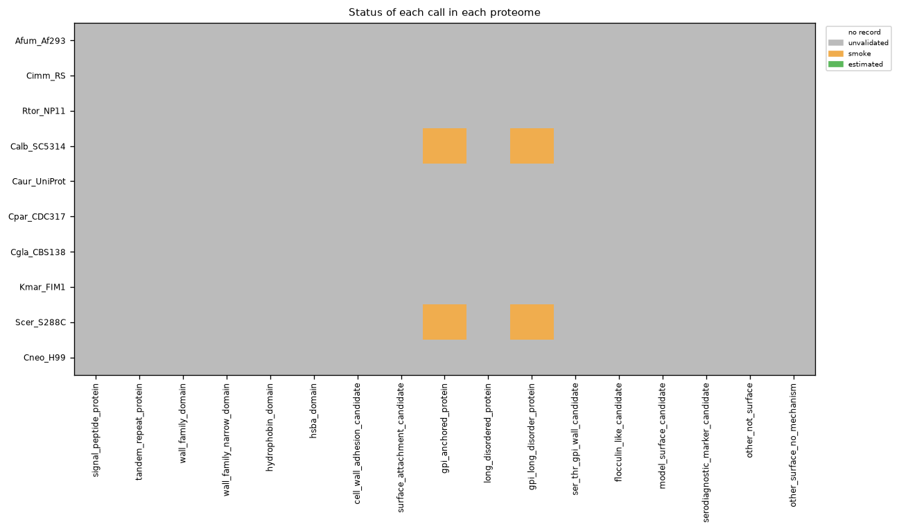
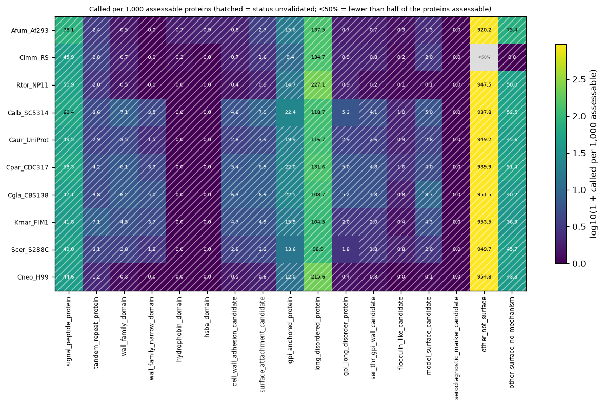
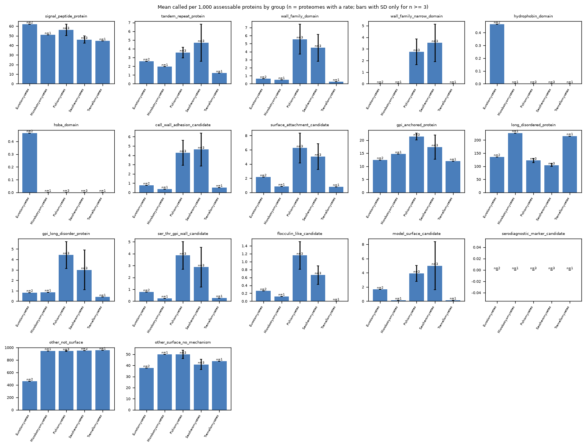

# cellsurface_sorting_hat aggregate report

- proteomes: 10; groups: 5 (rank `class`)
- calls read at the step 1 variant: `R0` (ungated calls have no variant)
- categories.yaml sha256 of the runs: d12d160697632ff5f92d673205c691a54714d2e6b13eec816ee10b6a515fe50b
- summaries over: all proteomes

## Proteomes

| proteome | taxon | group | proteins | invalid | modules without a table |
|---|---|---|---|---|---|
| Afum_Af293 | 330879 | Eurotiomycetes | 9647 | 0 | allergen_homology,antigen_lookup |
| Cimm_RS | 246410 | Eurotiomycetes | 9712 | 0 | allergen_homology,antigen_lookup |
| Rtor_NP11 | 1130832 | Microbotryomycetes | 8160 | 0 | allergen_homology,antigen_lookup |
| Calb_SC5314 | 237561 | Pichiomycetes | 6041 | 0 | allergen_homology,antigen_lookup |
| Caur_UniProt | 498019 | Pichiomycetes | 5433 | 0 | allergen_homology,antigen_lookup |
| Cpar_CDC317 | 578454 | Pichiomycetes | 5777 | 0 | allergen_homology,antigen_lookup |
| Cgla_CBS138 | 284593 | Saccharomycetes | 5200 | 0 | allergen_homology,antigen_lookup |
| Kmar_FIM1 | 4911 | Saccharomycetes | 5070 | 0 | allergen_homology,antigen_lookup |
| Scer_S288C | 559292 | Saccharomycetes | 6067 | 0 | allergen_homology,antigen_lookup |
| Cneo_H99 | 235443 | Tremellomycetes | 7427 | 0 | allergen_homology,antigen_lookup |

## Group summaries

Called per 1,000 assessable proteins. `n` = proteomes of the group, `meas` = proteomes in which the call has a measured status; * = no measured status in any of them.

### `signal_peptide_protein`

| group | n | low | meas | mean [min, max] | median | pooled | called / assessable |
|---|---|---|---|---|---|---|---|
| Eurotiomycetes* | 2 | 0 | 0 | 61.99 [45.92, 78.06] | 61.99 | 61.94 | 1199 / 19359 |
| Microbotryomycetes* | 1 | 0 | 0 | 50.86 [50.86, 50.86] | 50.86 | 50.86 | 415 / 8160 |
| Pichiomycetes* | 3 | 0 | 0 | 56.09 [49.51, 60.42] | 58.33 | 56.29 | 971 / 17251 |
| Saccharomycetes* | 3 | 0 | 0 | 45.96 [41.81, 48.95] | 47.12 | 46.15 | 754 / 16337 |
| Tremellomycetes* | 1 | 0 | 0 | 44.57 [44.57, 44.57] | 44.57 | 44.57 | 331 / 7427 |

### `tandem_repeat_protein`

| group | n | low | meas | mean [min, max] | median | pooled | called / assessable |
|---|---|---|---|---|---|---|---|
| Eurotiomycetes* | 2 | 0 | 0 | 2.58 [2.38, 2.78] | 2.58 | 2.58 | 50 / 19359 |
| Microbotryomycetes* | 1 | 0 | 0 | 1.96 [1.96, 1.96] | 1.96 | 1.96 | 16 / 8160 |
| Pichiomycetes* | 3 | 0 | 0 | 3.58 [2.94, 4.15] | 3.64 | 3.59 | 62 / 17251 |
| Saccharomycetes* | 3 | 0 | 0 | 4.69 [3.13, 7.10] | 3.85 | 4.59 | 75 / 16337 |
| Tremellomycetes* | 1 | 0 | 0 | 1.21 [1.21, 1.21] | 1.21 | 1.21 | 9 / 7427 |

### `wall_family_domain`

| group | n | low | meas | mean [min, max] | median | pooled | called / assessable |
|---|---|---|---|---|---|---|---|
| Eurotiomycetes* | 2 | 0 | 0 | 0.62 [0.52, 0.72] | 0.62 | 0.62 | 12 / 19359 |
| Microbotryomycetes* | 1 | 0 | 0 | 0.49 [0.49, 0.49] | 0.49 | 0.49 | 4 / 8160 |
| Pichiomycetes* | 3 | 0 | 0 | 5.56 [3.50, 7.12] | 6.06 | 5.62 | 97 / 17251 |
| Saccharomycetes* | 3 | 0 | 0 | 4.50 [2.80, 6.15] | 4.54 | 4.41 | 72 / 16337 |
| Tremellomycetes* | 1 | 0 | 0 | 0.27 [0.27, 0.27] | 0.27 | 0.27 | 2 / 7427 |

### `wall_family_narrow_domain`

| group | n | low | meas | mean [min, max] | median | pooled | called / assessable |
|---|---|---|---|---|---|---|---|
| Eurotiomycetes* | 2 | 0 | 0 | 0.00 [0.00, 0.00] | 0.00 | 0.00 | 0 / 19359 |
| Microbotryomycetes* | 1 | 0 | 0 | 0.00 [0.00, 0.00] | 0.00 | 0.00 | 0 / 8160 |
| Pichiomycetes* | 3 | 0 | 0 | 2.75 [1.47, 3.48] | 3.29 | 2.78 | 48 / 17251 |
| Saccharomycetes* | 3 | 0 | 0 | 3.52 [1.81, 5.00] | 3.75 | 3.43 | 56 / 16337 |
| Tremellomycetes* | 1 | 0 | 0 | 0.00 [0.00, 0.00] | 0.00 | 0.00 | 0 / 7427 |

### `hydrophobin_domain`

| group | n | low | meas | mean [min, max] | median | pooled | called / assessable |
|---|---|---|---|---|---|---|---|
| Eurotiomycetes* | 2 | 0 | 0 | 0.47 [0.21, 0.73] | 0.47 | 0.46 | 9 / 19359 |
| Microbotryomycetes* | 1 | 0 | 0 | 0.00 [0.00, 0.00] | 0.00 | 0.00 | 0 / 8160 |
| Pichiomycetes* | 3 | 0 | 0 | 0.00 [0.00, 0.00] | 0.00 | 0.00 | 0 / 17251 |
| Saccharomycetes* | 3 | 0 | 0 | 0.00 [0.00, 0.00] | 0.00 | 0.00 | 0 / 16337 |
| Tremellomycetes* | 1 | 0 | 0 | 0.00 [0.00, 0.00] | 0.00 | 0.00 | 0 / 7427 |

### `hsba_domain`

| group | n | low | meas | mean [min, max] | median | pooled | called / assessable |
|---|---|---|---|---|---|---|---|
| Eurotiomycetes* | 2 | 0 | 0 | 0.47 [0.00, 0.93] | 0.47 | 0.46 | 9 / 19359 |
| Microbotryomycetes* | 1 | 0 | 0 | 0.00 [0.00, 0.00] | 0.00 | 0.00 | 0 / 8160 |
| Pichiomycetes* | 3 | 0 | 0 | 0.00 [0.00, 0.00] | 0.00 | 0.00 | 0 / 17251 |
| Saccharomycetes* | 3 | 0 | 0 | 0.00 [0.00, 0.00] | 0.00 | 0.00 | 0 / 16337 |
| Tremellomycetes* | 1 | 0 | 0 | 0.00 [0.00, 0.00] | 0.00 | 0.00 | 0 / 7427 |

### `cell_wall_adhesion_candidate`

| group | n | low | meas | mean [min, max] | median | pooled | called / assessable |
|---|---|---|---|---|---|---|---|
| Eurotiomycetes* | 2 | 0 | 0 | 0.78 [0.72, 0.83] | 0.78 | 0.77 | 15 / 19359 |
| Microbotryomycetes* | 1 | 0 | 0 | 0.37 [0.37, 0.37] | 0.37 | 0.37 | 3 / 8160 |
| Pichiomycetes* | 3 | 0 | 0 | 4.25 [2.76, 5.37] | 4.63 | 4.29 | 74 / 17251 |
| Saccharomycetes* | 3 | 0 | 0 | 4.63 [2.80, 6.35] | 4.73 | 4.53 | 74 / 16337 |
| Tremellomycetes* | 1 | 0 | 0 | 0.54 [0.54, 0.54] | 0.54 | 0.54 | 4 / 7427 |

### `surface_attachment_candidate`

| group | n | low | meas | mean [min, max] | median | pooled | called / assessable |
|---|---|---|---|---|---|---|---|
| Eurotiomycetes* | 2 | 0 | 0 | 2.17 [1.65, 2.70] | 2.17 | 2.17 | 42 / 19359 |
| Microbotryomycetes* | 1 | 0 | 0 | 0.86 [0.86, 0.86] | 0.86 | 0.86 | 7 / 8160 |
| Pichiomycetes* | 3 | 0 | 0 | 6.24 [3.87, 7.95] | 6.92 | 6.32 | 109 / 17251 |
| Saccharomycetes* | 3 | 0 | 0 | 5.05 [3.30, 6.92] | 4.93 | 4.96 | 81 / 16337 |
| Tremellomycetes* | 1 | 0 | 0 | 0.81 [0.81, 0.81] | 0.81 | 0.81 | 6 / 7427 |

### `gpi_anchored_protein`

| group | n | low | meas | mean [min, max] | median | pooled | called / assessable |
|---|---|---|---|---|---|---|---|
| Eurotiomycetes* | 2 | 0 | 0 | 12.46 [9.37, 15.56] | 12.46 | 12.45 | 241 / 19352 |
| Microbotryomycetes* | 1 | 0 | 0 | 14.71 [14.71, 14.71] | 14.71 | 14.71 | 120 / 8160 |
| Pichiomycetes | 3 | 0 | 1 | 21.41 [19.88, 22.37] | 22.00 | 21.46 | 370 / 17242 |
| Saccharomycetes | 3 | 0 | 1 | 17.34 [13.64, 22.52] | 15.87 | 17.17 | 279 / 16248 |
| Tremellomycetes* | 1 | 0 | 0 | 11.98 [11.98, 11.98] | 11.98 | 11.98 | 89 / 7426 |

### `long_disordered_protein`

| group | n | low | meas | mean [min, max] | median | pooled | called / assessable |
|---|---|---|---|---|---|---|---|
| Eurotiomycetes* | 2 | 0 | 0 | 136.07 [134.68, 137.45] | 136.07 | 136.06 | 2634 / 19359 |
| Microbotryomycetes* | 1 | 0 | 0 | 227.08 [227.08, 227.08] | 227.08 | 227.08 | 1853 / 8160 |
| Pichiomycetes* | 3 | 0 | 0 | 122.31 [116.69, 131.56] | 118.69 | 122.37 | 2111 / 17251 |
| Saccharomycetes* | 3 | 0 | 0 | 104.03 [98.90, 108.65] | 104.54 | 103.75 | 1695 / 16337 |
| Tremellomycetes* | 1 | 0 | 0 | 215.56 [215.56, 215.56] | 215.56 | 215.56 | 1601 / 7427 |

### `gpi_long_disorder_protein`

| group | n | low | meas | mean [min, max] | median | pooled | called / assessable |
|---|---|---|---|---|---|---|---|
| Eurotiomycetes* | 2 | 0 | 0 | 0.83 [0.73, 0.93] | 0.83 | 0.83 | 16 / 19359 |
| Microbotryomycetes* | 1 | 0 | 0 | 0.86 [0.86, 0.86] | 0.86 | 0.86 | 7 / 8160 |
| Pichiomycetes | 3 | 0 | 1 | 4.42 [2.94, 5.30] | 5.02 | 4.46 | 77 / 17251 |
| Saccharomycetes | 3 | 0 | 1 | 2.99 [1.81, 5.19] | 1.97 | 2.94 | 48 / 16337 |
| Tremellomycetes* | 1 | 0 | 0 | 0.40 [0.40, 0.40] | 0.40 | 0.40 | 3 / 7427 |

### `ser_thr_gpi_wall_candidate`

| group | n | low | meas | mean [min, max] | median | pooled | called / assessable |
|---|---|---|---|---|---|---|---|
| Eurotiomycetes* | 2 | 0 | 0 | 0.77 [0.73, 0.82] | 0.77 | 0.77 | 15 / 19359 |
| Microbotryomycetes* | 1 | 0 | 0 | 0.25 [0.25, 0.25] | 0.25 | 0.25 | 2 / 8160 |
| Pichiomycetes* | 3 | 0 | 0 | 3.85 [2.58, 4.85] | 4.14 | 3.88 | 67 / 17251 |
| Saccharomycetes* | 3 | 0 | 0 | 2.86 [1.81, 4.81] | 1.97 | 2.82 | 46 / 16337 |
| Tremellomycetes* | 1 | 0 | 0 | 0.27 [0.27, 0.27] | 0.27 | 0.27 | 2 / 7427 |

### `flocculin_like_candidate`

| group | n | low | meas | mean [min, max] | median | pooled | called / assessable |
|---|---|---|---|---|---|---|---|
| Eurotiomycetes* | 2 | 0 | 0 | 0.26 [0.21, 0.31] | 0.26 | 0.26 | 5 / 19359 |
| Microbotryomycetes* | 1 | 0 | 0 | 0.12 [0.12, 0.12] | 0.12 | 0.12 | 1 / 8160 |
| Pichiomycetes* | 3 | 0 | 0 | 1.16 [0.92, 1.56] | 0.99 | 1.16 | 20 / 17251 |
| Saccharomycetes* | 3 | 0 | 0 | 0.66 [0.39, 0.82] | 0.77 | 0.67 | 11 / 16337 |
| Tremellomycetes* | 1 | 0 | 0 | 0.00 [0.00, 0.00] | 0.00 | 0.00 | 0 / 7427 |

### `model_surface_candidate`

| group | n | low | meas | mean [min, max] | median | pooled | called / assessable |
|---|---|---|---|---|---|---|---|
| Eurotiomycetes* | 2 | 0 | 0 | 1.65 [1.35, 1.96] | 1.65 | 1.65 | 32 / 19359 |
| Microbotryomycetes* | 1 | 0 | 0 | 0.12 [0.12, 0.12] | 0.12 | 0.12 | 1 / 8160 |
| Pichiomycetes* | 3 | 0 | 0 | 3.90 [2.76, 4.97] | 3.98 | 3.94 | 68 / 17251 |
| Saccharomycetes* | 3 | 0 | 0 | 4.99 [1.98, 8.65] | 4.34 | 4.84 | 79 / 16337 |
| Tremellomycetes* | 1 | 0 | 0 | 0.13 [0.13, 0.13] | 0.13 | 0.13 | 1 / 7427 |

### `cocci_specificity_rank_top15`

| group | n | low | meas | mean [min, max] | median | pooled | called / assessable |
|---|---|---|---|---|---|---|---|
| Eurotiomycetes* | 2 | 2 | 0 | NA [NA, NA] | NA | NA | 0 / 0 |
| Microbotryomycetes* | 1 | 1 | 0 | NA [NA, NA] | NA | NA | 0 / 0 |
| Pichiomycetes* | 3 | 3 | 0 | NA [NA, NA] | NA | NA | 0 / 0 |
| Saccharomycetes* | 3 | 3 | 0 | NA [NA, NA] | NA | NA | 0 / 0 |
| Tremellomycetes* | 1 | 1 | 0 | NA [NA, NA] | NA | NA | 0 / 0 |

### `serodiagnostic_marker_candidate`

| group | n | low | meas | mean [min, max] | median | pooled | called / assessable |
|---|---|---|---|---|---|---|---|
| Eurotiomycetes* | 2 | 0 | 0 | 0.00 [0.00, 0.00] | 0.00 | 0.00 | 0 / 18913 |
| Microbotryomycetes* | 1 | 0 | 0 | 0.00 [0.00, 0.00] | 0.00 | 0.00 | 0 / 8160 |
| Pichiomycetes* | 3 | 0 | 0 | 0.00 [0.00, 0.00] | 0.00 | 0.00 | 0 / 17251 |
| Saccharomycetes* | 3 | 0 | 0 | 0.00 [0.00, 0.00] | 0.00 | 0.00 | 0 / 16337 |
| Tremellomycetes* | 1 | 0 | 0 | 0.00 [0.00, 0.00] | 0.00 | 0.00 | 0 / 7427 |

### `iuis_allergen_similarity`

| group | n | low | meas | mean [min, max] | median | pooled | called / assessable |
|---|---|---|---|---|---|---|---|
| Eurotiomycetes* | 2 | 2 | 0 | NA [NA, NA] | NA | NA | 0 / 0 |
| Microbotryomycetes* | 1 | 1 | 0 | NA [NA, NA] | NA | NA | 0 / 0 |
| Pichiomycetes* | 3 | 3 | 0 | NA [NA, NA] | NA | NA | 0 / 0 |
| Saccharomycetes* | 3 | 3 | 0 | NA [NA, NA] | NA | NA | 0 / 0 |
| Tremellomycetes* | 1 | 1 | 0 | NA [NA, NA] | NA | NA | 0 / 0 |

### `iuis_allergen_homolog`

| group | n | low | meas | mean [min, max] | median | pooled | called / assessable |
|---|---|---|---|---|---|---|---|
| Eurotiomycetes* | 2 | 2 | 0 | NA [NA, NA] | NA | NA | 0 / 0 |
| Microbotryomycetes* | 1 | 1 | 0 | NA [NA, NA] | NA | NA | 0 / 0 |
| Pichiomycetes* | 3 | 3 | 0 | NA [NA, NA] | NA | NA | 0 / 0 |
| Saccharomycetes* | 3 | 3 | 0 | NA [NA, NA] | NA | NA | 0 / 0 |
| Tremellomycetes* | 1 | 1 | 0 | NA [NA, NA] | NA | NA | 0 / 0 |

### `other_not_surface`

| group | n | low | meas | mean [min, max] | median | pooled | called / assessable |
|---|---|---|---|---|---|---|---|
| Eurotiomycetes* | 2 | 1 | 0 | 920.18 [920.18, 920.18] | 920.18 | 920.18 | 8877 / 9647 |
| Microbotryomycetes* | 1 | 0 | 0 | 947.55 [947.55, 947.55] | 947.55 | 947.55 | 7732 / 8160 |
| Pichiomycetes* | 3 | 0 | 0 | 942.30 [937.76, 949.20] | 939.93 | 942.09 | 16252 / 17251 |
| Saccharomycetes* | 3 | 0 | 0 | 951.57 [949.73, 953.45] | 951.54 | 951.46 | 15544 / 16337 |
| Tremellomycetes* | 1 | 0 | 0 | 954.76 [954.76, 954.76] | 954.76 | 954.76 | 7091 / 7427 |

### `other_surface_no_mechanism`

| group | n | low | meas | mean [min, max] | median | pooled | called / assessable |
|---|---|---|---|---|---|---|---|
| Eurotiomycetes* | 2 | 0 | 0 | 37.68 [0.00, 75.36] | 37.68 | 38.41 | 727 / 18929 |
| Microbotryomycetes* | 1 | 0 | 0 | 50.00 [50.00, 50.00] | 50.00 | 50.00 | 408 / 8160 |
| Pichiomycetes* | 3 | 0 | 0 | 49.84 [45.65, 52.47] | 51.41 | 49.97 | 862 / 17251 |
| Saccharomycetes* | 3 | 0 | 0 | 40.91 [36.88, 45.66] | 40.19 | 41.19 | 673 / 16337 |
| Tremellomycetes* | 1 | 0 | 0 | 43.76 [43.76, 43.76] | 43.76 | 43.76 | 325 / 7427 |

## Status coverage

4 of 200 proteome-call cells have a measured status.

## Figures

## Warnings

- **WARNING: Afum_Af293: no protein is assessable for 3 call(s) (rate NA): `cocci_specificity_rank_top15`, `iuis_allergen_similarity`, `iuis_allergen_homolog`; modules without a table in that run: allergen_homology, antigen_lookup.**
- **WARNING: Cimm_RS: no protein is assessable for 3 call(s) (rate NA): `cocci_specificity_rank_top15`, `iuis_allergen_similarity`, `iuis_allergen_homolog`; modules without a table in that run: allergen_homology, antigen_lookup.**
- **WARNING: Cimm_RS: more than 5% of the proteins are not assessable for `other_not_surface` (95%); the denominators are smaller.**
- **WARNING: Rtor_NP11: no protein is assessable for 3 call(s) (rate NA): `cocci_specificity_rank_top15`, `iuis_allergen_similarity`, `iuis_allergen_homolog`; modules without a table in that run: allergen_homology, antigen_lookup.**
- **WARNING: Calb_SC5314: no protein is assessable for 3 call(s) (rate NA): `cocci_specificity_rank_top15`, `iuis_allergen_similarity`, `iuis_allergen_homolog`; modules without a table in that run: allergen_homology, antigen_lookup.**
- **WARNING: Caur_UniProt: no protein is assessable for 3 call(s) (rate NA): `cocci_specificity_rank_top15`, `iuis_allergen_similarity`, `iuis_allergen_homolog`; modules without a table in that run: allergen_homology, antigen_lookup.**
- **WARNING: Cpar_CDC317: no protein is assessable for 3 call(s) (rate NA): `cocci_specificity_rank_top15`, `iuis_allergen_similarity`, `iuis_allergen_homolog`; modules without a table in that run: allergen_homology, antigen_lookup.**
- **WARNING: Cgla_CBS138: no protein is assessable for 3 call(s) (rate NA): `cocci_specificity_rank_top15`, `iuis_allergen_similarity`, `iuis_allergen_homolog`; modules without a table in that run: allergen_homology, antigen_lookup.**
- **WARNING: Kmar_FIM1: no protein is assessable for 3 call(s) (rate NA): `cocci_specificity_rank_top15`, `iuis_allergen_similarity`, `iuis_allergen_homolog`; modules without a table in that run: allergen_homology, antigen_lookup.**
- **WARNING: Scer_S288C: no protein is assessable for 3 call(s) (rate NA): `cocci_specificity_rank_top15`, `iuis_allergen_similarity`, `iuis_allergen_homolog`; modules without a table in that run: allergen_homology, antigen_lookup.**
- **WARNING: Cneo_H99: no protein is assessable for 3 call(s) (rate NA): `cocci_specificity_rank_top15`, `iuis_allergen_similarity`, `iuis_allergen_homolog`; modules without a table in that run: allergen_homology, antigen_lookup.**
- **WARNING: Group `Eurotiomycetes` has 2 proteome(s): a mean over so few is descriptive only.**
- **WARNING: Group `Microbotryomycetes` has 1 proteome(s): a mean over so few is descriptive only.**
- **WARNING: Group `Tremellomycetes` has 1 proteome(s): a mean over so few is descriptive only.**

## Known limits

- A count is a count of calls. It is not a prevalence and not corrected for false positives; expected false calls need a measured specificity, which most calls do not have.
- A proteome-call cell with fewer than half of its proteins assessable is flagged (`low_assessable`) and left out of the group summaries: its rate depends on which proteins happen to be assessable (for example a call that is assessable only where it is called has a rate of 1,000 by construction).
- Rates are per 1,000 assessable proteins for that call in that proteome (a protein that is not assessable for the call is left out of the denominator). Proteomes differ in size, annotation quality and completeness; a mean over proteomes of unequal size is a descriptive number, not an estimate, and `n` is printed beside it. A call marked * has the status `unvalidated` in that proteome.
- The status of a call is for one species and taxon and only where its status file is installed and current. A call that reads a module without a table in the run is `not_assessable` for every protein and is shown as NA.
- A call that uses clade thresholds (for example `model_surface_candidate`) is calibrated only for the clades its thresholds table lists as calibrated; elsewhere its count is not comparable.
